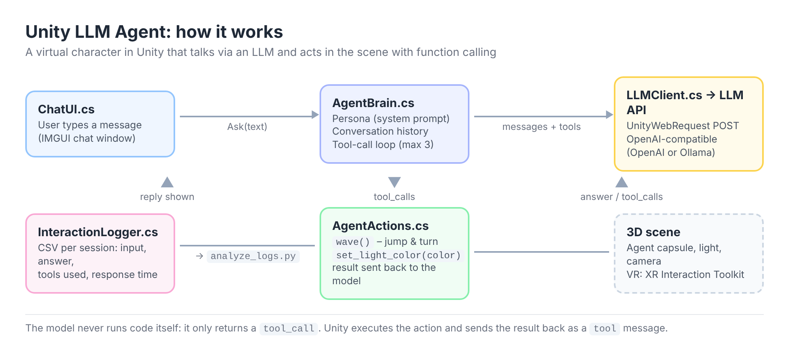

# Unity LLM Agent – a virtual character you can talk to

A small Unity project in which a virtual character ("Mia") talks to the user through a large language model (LLM).
The agent can also **act in the 3D scene** using *function calling*: it can wave (jump and turn) and change the color of the light.
Every interaction is saved as a CSV file, so it can be analysed afterwards, for example in a user study.

I built this project to learn Unity, C#, and how LLM-based agents can be integrated into interactive/VR applications.

<!-- Demo GIF coming soon: docs/demo.gif -->

## Features

- 3D scene with a simple agent character (Unity, C#)
- Chat with an LLM via an OpenAI-compatible API (OpenAI or a local model with [Ollama](https://ollama.com))
- Agent persona (system prompt) and conversation history as context
- **Function calling**: the model decides when to call `wave()` or `set_light_color(color)`, Unity executes it
- Interaction logging to CSV (input, answer, tools used, response time) + a small Python analysis script
- Prepared for VR with the XR Interaction Toolkit (see below)

## How it works



| Script | What it does |
|---|---|
| `LLMClient.cs` | Sends the request with `UnityWebRequest`, reads the config file |
| `AgentBrain.cs` | Persona, conversation history, tool-call loop, error handling |
| `AgentActions.cs` | Tool definitions (JSON schema) and the actions in the scene |
| `ChatUI.cs` | Simple chat window with IMGUI (for desktop testing) |
| `InteractionLogger.cs` | Writes one CSV file per session |
| `analysis/analyze_logs.py` | Response times, tool usage and message length from the logs |

## Setup

Built with Unity 6 LTS (should also work with 2022.3 LTS).

1. **Create the project:** In Unity Hub, create a new **3D** project and copy the `Assets/Scripts` folder of this repo into its `Assets` folder.
2. **Install Newtonsoft JSON:** *Window → Package Manager → + → Add package by name* → `com.unity.nuget.newtonsoft-json`
3. **API key:** Copy `llm_config.example.json` to `llm_config.json` (in the project root, next to the `Assets` folder) and add your key.
   `llm_config.json` is in `.gitignore`, so **never commit your key**.

   To use a free local model instead of OpenAI, install Ollama, run `ollama pull llama3.2`, and use:
   ```json
   { "apiUrl": "http://localhost:11434/v1/chat/completions", "apiKey": "ollama", "model": "llama3.2" }
   ```
   (Because this is `http`, set *Project Settings → Player → Other Settings → Allow downloads over HTTP* to *Always allowed*.)
4. **Build the scene:**
   - *GameObject → 3D Object → Plane* (the floor)
   - *GameObject → 3D Object → Capsule*, name it `Agent`, position `(0, 1, 3)`
   - Main Camera position `(0, 1.6, 0)`, rotation `(0, 0, 0)`
   - Create an empty GameObject `AgentSystem` and add all five scripts to it
5. **Connect the references in the Inspector:**
   - `AgentActions`: Agent Body → `Agent`, Scene Light → `Directional Light`
   - `AgentBrain`: Llm, Actions, Logger → the components on `AgentSystem`
   - `ChatUI`: Brain → `AgentBrain`
6. **Press Play** and try:
   - "Hallo!" → Mia answers and waves
   - "Kannst du das Licht blau machen?" → the light turns blue
   - "Mach es wieder normal" → the light turns white

The Console shows where the CSV log is saved (`Application.persistentDataPath/logs`).
Analyse it with:
```bash
pip install pandas
python analysis/analyze_logs.py <path-to-logs-folder>
```

## VR (XR Interaction Toolkit)

1. Package Manager → install **XR Interaction Toolkit** and **OpenXR Plugin**
2. *Project Settings → XR Plug-in Management* → enable **OpenXR** (+ the profile for your headset, e.g. Meta Quest)
3. Delete the Main Camera and add *GameObject → XR → XR Origin (VR)* at `(0, 0, 0)`

The IMGUI chat window only works on the desktop. In VR, the next step is a world-space canvas or speech input (see "Next steps").

## What I learned

- Unity basics: GameObjects, components, the Inspector, coroutines for animations and web requests
- C#: classes, events (`Action<string>`), callbacks, `switch`, working with JSON (`Newtonsoft.Json.Linq`)
- How function calling works: the model only *suggests* a tool call, the application executes it and sends the result back
- Keeping the conversation history valid (tool messages must follow their assistant message) and limiting its size
- Keeping API keys out of Git

## Next steps

- [ ] World-space chat panel for VR
- [ ] Speech input / output (speech-to-text, text-to-speech)
- [ ] A humanoid character with animations instead of the capsule
- [ ] Compare two agent personas in a small user test using the CSV logs

## License

MIT
